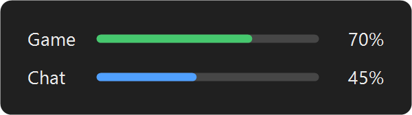

<div align="center">


# MixDial

**Use the game/chat mix dial on your SteelSeries Arctis 7+ — without SteelSeries GG.**

[](https://github.com/dialworks/MixDial/releases/latest)
[](https://github.com/dialworks/MixDial/releases)
[](#requirements)
[](LICENSE)



<sub>Unofficial community project — not affiliated with or endorsed by SteelSeries. See <a href="#legal">Legal</a>.</sub>

</div>

---

MixDial is a tiny tray app that reads the mix dial straight from the headset's USB dongle and turns it into
per-app volume. **Chat apps** (Discord, TeamSpeak, Teams, …) follow the chat side of the dial, and
**everything else** playing on the headset follows the game side.

No drivers, no installer, no background services, no telemetry — one small exe, built from a single C# file
you can read in a few minutes.

## ✨ Features

|   |   |
|---|---|
| 🎚️ **Hardware dial works again** | Turn the dial, and game and chat apps balance against each other |
| 📊 **Live tray icon** | Two bars show the current mix at a glance (grey when the headset is off) |
| 🪟 **On-screen popup** | A small overlay while you turn the dial (optional, never steals focus) |
| 🔋 **Battery & charging** | Battery level in the tray menu, plus a heads-up when it runs low |
| 🔔 **Connect notifications** | Know when the headset connects, turns off or goes out of range |
| 💬 **Pick your chat apps** | Tick apps right from the tray menu, or edit a plain text list |
| 🚀 **Start with Windows** | One click, runs quietly in the tray |
| ↩️ **Leaves no mess** | App volumes go back to 100% when you pause or quit |

## 🚀 Quick start

1. Download **`MixDial.exe`** from the [latest release](https://github.com/dialworks/MixDial/releases/latest).
2. Close SteelSeries GG if it's running.
3. Run `MixDial.exe` — the icon appears in the tray.
4. Right-click it → **Start with Windows**.

That's it. Turn the dial.

> [!NOTE]
> The exe isn't code-signed, so SmartScreen may say *"Windows protected your PC"* the first time —
> click **More info → Run anyway**. If **Smart App Control** blocks it completely, use
> [Run from source](#run-from-source) instead.

## 🎧 Compatible headsets

| Headset                       | USB ID      |
|-------------------------------|-------------|
| SteelSeries Arctis 7+         | `1038:220E` |
| SteelSeries Arctis 7P+        | `1038:2212` |
| SteelSeries Arctis 7X+        | `1038:2216` |
| SteelSeries Arctis 7+ Destiny | `1038:2236` |

Have a different model? Other headsets use a different protocol, so they aren't supported yet —
[open an issue](https://github.com/dialworks/MixDial/issues) or send a pull request.

## 🖱️ Usage

Right-click the tray icon:

| Menu item | What it does |
|---|---|
| **Chat apps** | Lists apps currently playing on the headset — tick the ones that should follow the chat side. *Edit chat app list…* opens the full list in Notepad. |
| **Mix enabled** | Pause / resume. Pausing puts app volumes back to 100%. |
| **Show popup when turning dial** | Toggle the on-screen overlay. |
| **Notifications** | Toggle connect / disconnect / battery notifications. |
| **Start with Windows** | Launch MixDial when you log in. |

Common chat apps (Discord, TeamSpeak, Mumble, Teams, Zoom, Slack, Skype, WhatsApp, Telegram, …) are on the list
out of the box. The list lives in `%APPDATA%\MixDial\chat-apps.txt` — one process name per line, `#` for
comments — and changes apply as soon as you save.

## Requirements

- Windows 10 or 11
- .NET Framework 4.x (already part of Windows)
- SteelSeries GG **not** running at the same time — both would fight over the app volumes

## 🛠️ Build it yourself

No Visual Studio or SDK needed — Windows already ships a C# compiler:

```bat
build.bat
```

### Run from source

`Start-MixDial.ps1` compiles the code in memory and runs it inside PowerShell, so there's no unsigned exe for
Smart App Control to block:

```bat
conhost.exe --headless powershell.exe -NoProfile -STA -ExecutionPolicy Bypass -File Start-MixDial.ps1
```

**Start with Windows** works in this mode too.

## ❓ FAQ

<details>
<summary><b>Why per-app volume instead of separate Game and Chat devices like GG?</b></summary>
<br>
Without GG's virtual audio driver, Windows sees the headset as a single output device. MixDial sets each
app's volume on that device instead — exactly what the Windows Volume Mixer does — so no driver is needed.
</details>

<details>
<summary><b>An app isn't reacting to the dial.</b></summary>
<br>
Make sure it's playing through the headset (not your speakers) and has made a sound since it started.
Then check whether it's ticked in <b>Chat apps</b>: ticked apps follow chat, everything else follows game.
</details>

<details>
<summary><b>Does it change anything on the headset?</b></summary>
<br>
No. MixDial only reads from the headset. The one thing it ever sends is a status query — it never changes
headset settings or firmware.
</details>

<details>
<summary><b>How do I uninstall it?</b></summary>
<br>
Untick <b>Start with Windows</b>, quit from the tray, and delete <code>MixDial.exe</code>. To remove settings
too, delete <code>%APPDATA%\MixDial</code> and the registry key <code>HKCU\Software\MixDial</code>.
</details>

<details>
<summary><b>How does it talk to the dongle?</b></summary>
<br>

It listens on the dongle's vendor-specific HID interfaces:

| Interface (usage page) | Report | Meaning |
|---|---|---|
| `0xFF00` (push) | `45 <game> <chat>` | Dial moved (0–100 each) |
| `0xFF00` (push) | `BB <03 \| 00>` | Headset connected / off |
| `0xFF00` (push) | `B7 <0–4>` | Battery level changed |
| `0xFFC0` (request) | `B0` → `B0 <online> <battery> <charging> <game> <chat>` | Status query |

</details>

## Legal

MixDial is an independent project, made so that headsets people already own work with their own PC. It is
**not affiliated with, endorsed by, sponsored by, or supported by SteelSeries ApS**. Please don't contact
SteelSeries support about it — [open an issue](https://github.com/dialworks/MixDial/issues) here instead.

SteelSeries, Arctis, SteelSeries GG and ChatMix are trademarks of SteelSeries ApS. Discord, TeamSpeak,
Microsoft Teams and other product names mentioned are trademarks of their respective owners. They are used
here only to describe compatibility.

MixDial contains no SteelSeries code, software, firmware, logos or other assets. The icon is original.

The software is provided "as is", without warranty of any kind. Use it at your own risk.

## License

[MIT](LICENSE) © 2026 dialworks
